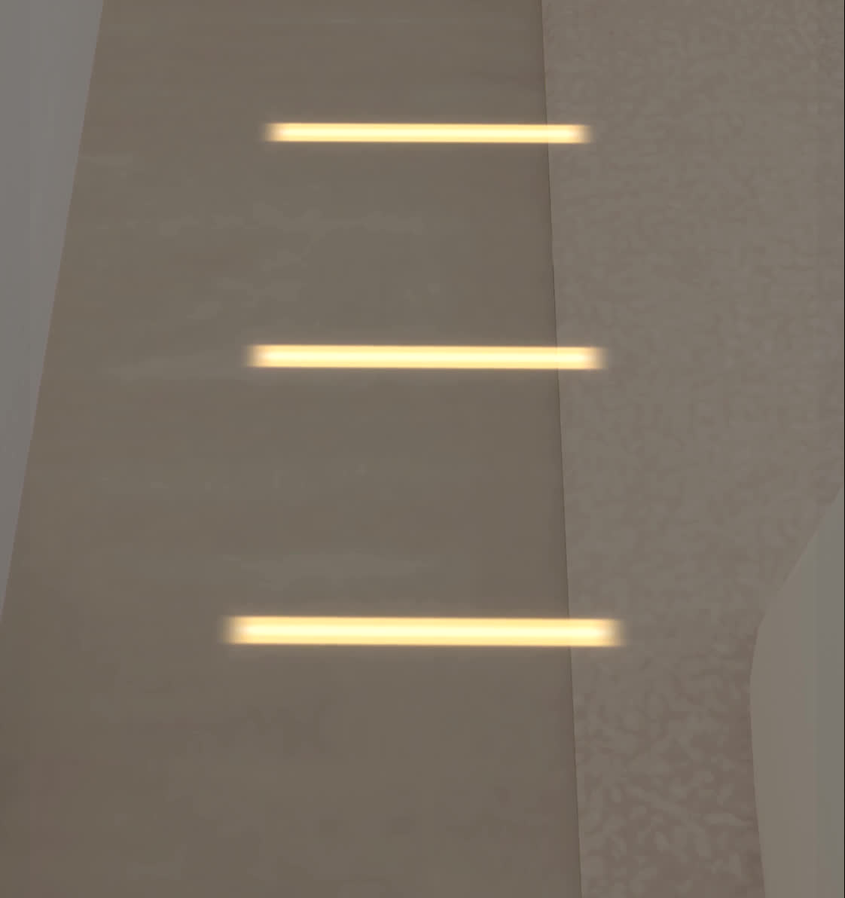
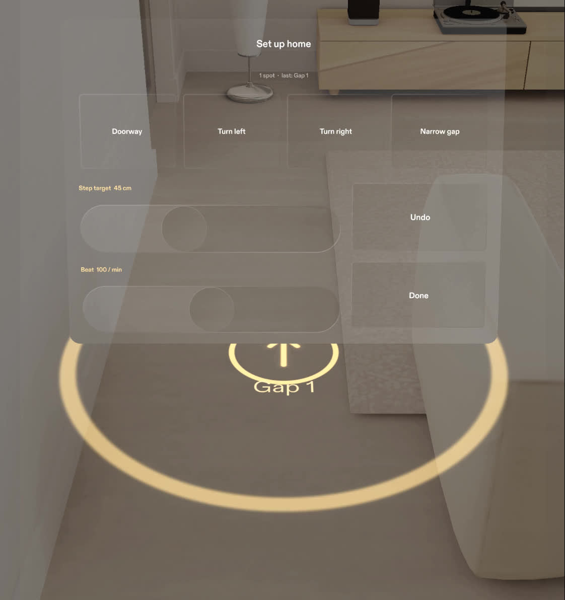
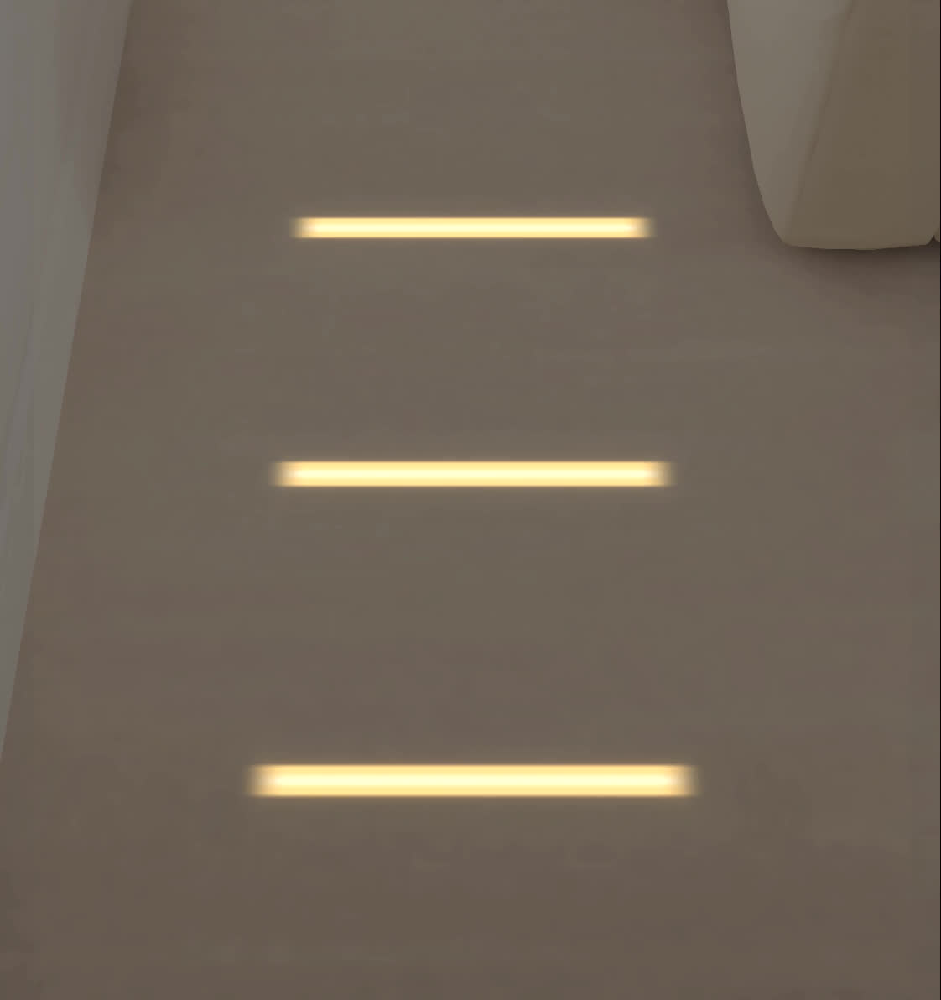
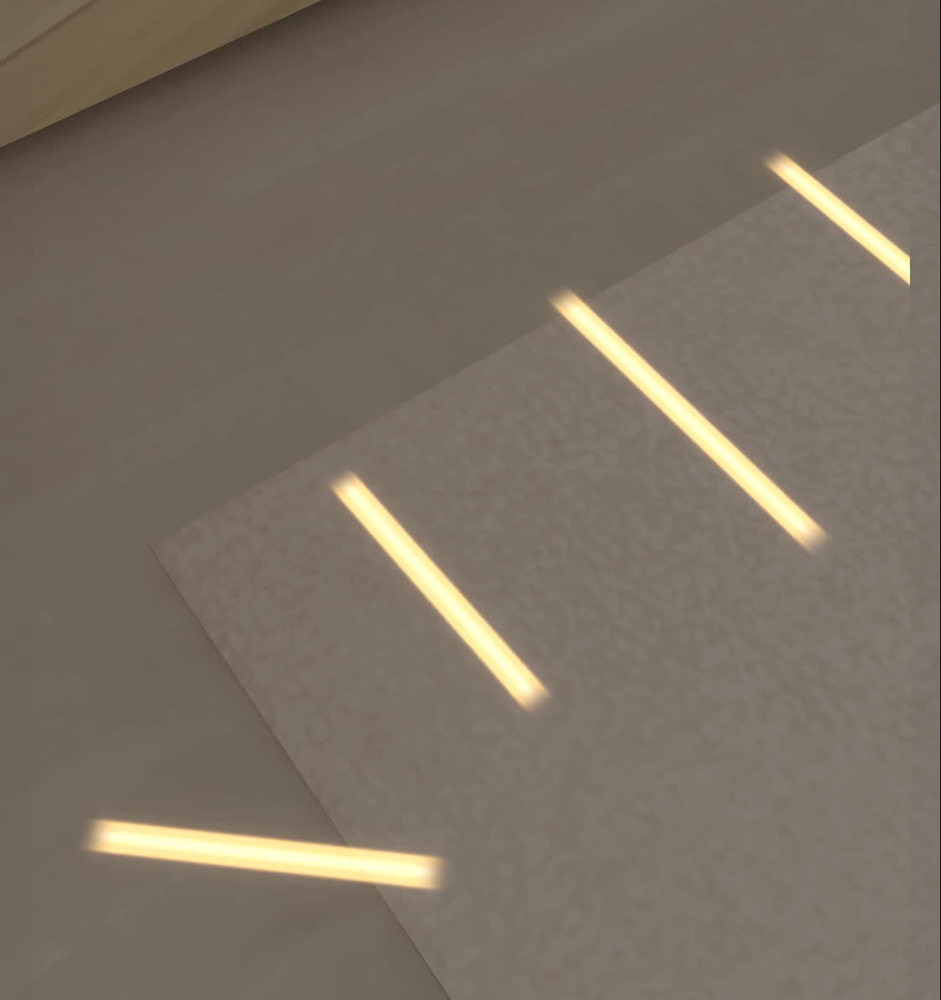
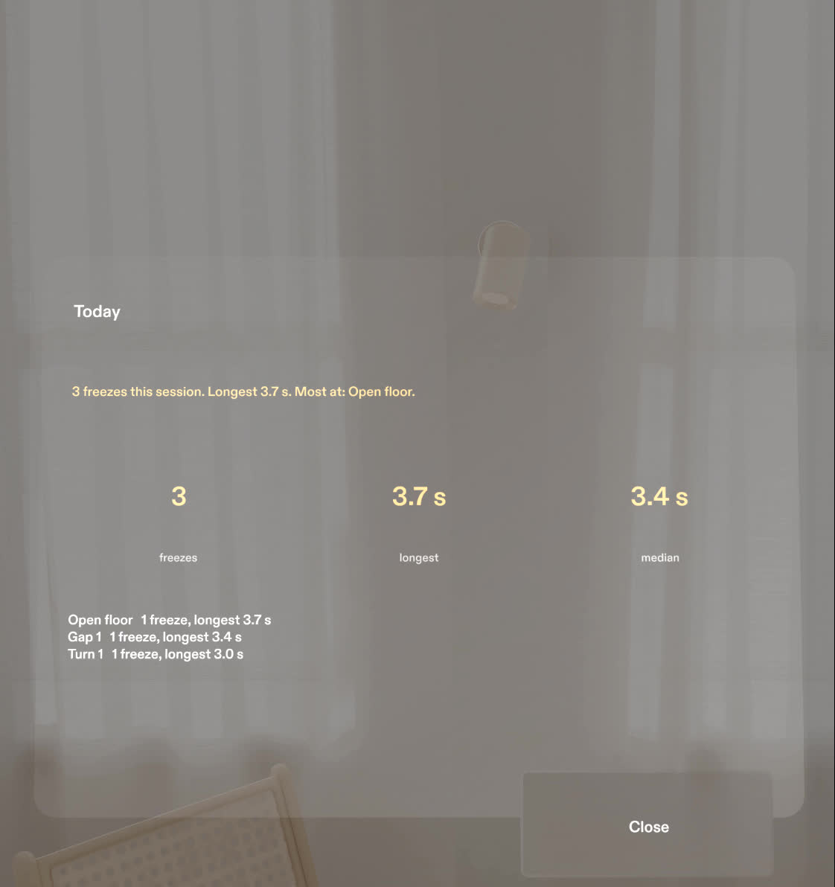
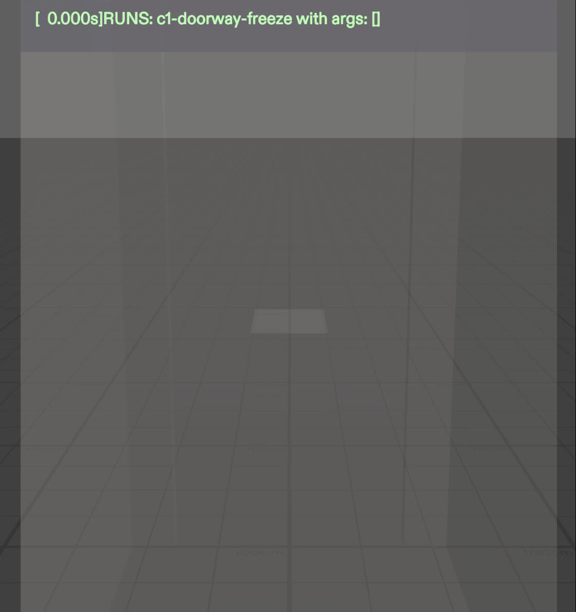

# Footlight

**A SPECS Lens for people with Parkinson's who freeze mid-step.** When a freeze starts in a narrow gap, at a turn or in a doorway, Footlight draws lines on the real floor at the person's own step length and plays a beat at their walking pace. Step over the first line and keep walking. Once the walk is steady, the lines fade and the beat stops.

Built for **Learn AR with SPECS** (Devpost Learn x Snap): planned with the Devpost `plan-lens` skill, built by Snap's CLAD agents through the Lens Studio MCP, tested with LEAF in the Lens Studio preview.

Video: <VIDEO URL>



## Why

Freezing of gait affects about 40% of people with Parkinson's, and about 71% after ten years with the disease ([meta-analysis of 29 studies](https://pmc.ncbi.nlm.nih.gov/articles/PMC7398304/)). Turning is the most common trigger, then doorways and dual tasks ([systematic review](https://pmc.ncbi.nlm.nih.gov/articles/PMC10771308/)).

Someone who cannot take one step forward can often step over a line. Physiotherapists teach it, and families stick tape across doorways. Tape is never where the next freeze happens, and lines that are always on the floor stop working. Footlight puts the line down at the moment of the freeze, in the place of the freeze, and removes it once the walk is steady.

## The experience

| | |
|---|---|
|  | **1. A carer sets it up once.** Look at the floor where the freeze happens and choose Doorway, Turn left, Turn right or Narrow gap. Each spot becomes a ring on the floor with its name. Two sliders hold the physiotherapist's numbers: step target (30 to 70 cm) and beat (80 to 120 per minute). |
|  | **2. Start hesitation.** A pinch anywhere brings up lines at once, from 22 cm ahead of the head's floor point, one per step, toward where the head points. |
|  | **3. A freeze in a marked spot.** Stopping inside a spot after walking brings up lines within a second. In a doorway or a gap they run square to the opening and carry on 110 cm past it. Each crossed line dims; after 1.5 s of steady walking the rest fade and the beat stops after two more beats. |
|  | **4. A turn.** The beat leads and stepping marks follow a 55 cm arc, then two lines on the new heading, the "turn like a clock" method. An AR study found that sound helped more than visual cues for turning ([Janssen et al. 2020](https://pmc.ncbi.nlm.nih.gov/articles/PMC7105859/)), so the beat starts first. |
|  | **5. Today.** The session's freezes: how many, the longest, the median, and where. |

Nothing shows while the walk is steady. The pill that opens the menu appears only when the person stands still with no cue on the floor.

### Designed for a narrow view

SPECS shows about 32 x 37 degrees. With eyes 160 cm above the floor and the view centred on the horizon, the nearest visible floor is about 4.8 m away, so lines at the toes need a downward look. Footlight answers this three ways: doorway and gap lines run on past the opening where a small glance finds them, the beat starts with the lines and needs no view at all, and a chevron at the lower edge points down only when none of the remaining lines is in view.

## How it was built

1. **Plan.** The `plan-lens` skill from [challengepost/learn-specs](https://github.com/challengepost/learn-specs) produced [`devpost/design-brief.md`](devpost/design-brief.md): the one spatial moment, placement in centimetres, show rules, the preview stand-ins and five done criteria.
2. **Build.** Snap's CLAD plugin (`ls-clad` from [lens-studio-devs/ls-extensions](https://github.com/lens-studio-devs/ls-extensions), commit `8adedd5`) built the Lens from the brief through the Lens Studio MCP: scene, UI Kit panels, SIK interaction, generated beat sound, icons and the LEAF scenarios. Later passes fixed what the preview showed: panels moved inside the view, pinch read from SIK hand state, the Today card rebuilt for legibility.
3. **Test.** LEAF runs the five done criteria in the Lens Studio preview. The logic underneath has its own Node tests.

### Done criteria, tested with LEAF

| # | Done criterion | LEAF scenario | Result in the preview |
|---|---|---|---|
| 1 | Stopping in the doorway spot brings up lines within 1 s; the first line is 22 cm ahead; lines run square through the door | `c1-doorway-freeze` | Pass: lines 0.73 s after stopping, first line 22.00 cm ahead, 2 lines before the door and 2 through it |
| 2 | Line spacing equals the Step target slider | `c2-step-slider` | Pass: 60.0 cm spacing after the slider moves to 60 cm |
| 3 | A pinch anywhere brings up lines at once, with the beat | `c3-pinch-anywhere` | Pass: first line visible 0.09 s after the pinch registers, 3 beats in 1.3 s |
| 4 | Walking on dims crossed lines, then the lines fade and the beat stops | `c4-walk-through` | Pass: crossed lines dim to 0.15, fade seen, 0 beats after the fade |
| 5 | After a freeze and a restart, Today lists it with its duration | `c5-today-log` | Pass: "Bathroom door, 1 freeze, longest 3.0 s" |



LEAF cannot move the preview camera, so the scenarios walk through the controller's pose input (`setPoseOverride`), the same path the camera feeds every frame.

## Architecture

Every number on the floor is computed by plain TypeScript in `Assets/Scripts/Core`, with no Lens Studio dependency. The same files run in the Lens and in the Node tests.

| Claim | Code | Test |
|---|---|---|
| A freeze is a stop after walking: 0.4 s inside a marked spot, or a 1.3 s stop with 3-8 Hz trembling of head height on open floor | [`FreezeDetector.ts`](Assets/Scripts/Core/FreezeDetector.ts) | `tools/test/engine.test.ts`: "cues within one second of stopping in a doorway spot", "does not cue a calm stop on open floor", "cues a trembling stop on open floor" |
| First line 22 cm ahead (12 cm toe offset + 10 cm gap), then one per target step; doorway lines square to the door even off-centre | [`CueGeometry.ts`](Assets/Scripts/Core/CueGeometry.ts) | "spaces doorway lines at the target step", "squares doorway lines to the door when the person stops off-centre" |
| Turn marks on a 55 cm arc to the turning side, ending on the new heading | `CueGeometry.ts` `turnCues` | "sweeps a left turn on a wide arc and ends on the new heading" |
| Crossed lines dim, the rest fade after steady walking, the beat runs two beats into the fade | [`CueSequencer.ts`](Assets/Scripts/Core/CueSequencer.ts) | "dims crossed lines, then fades and stops the beat" |
| Repeat cues in the same place wait 2 s; a freeze at another spot always gets lines | [`FootlightEngine.ts`](Assets/Scripts/Core/FootlightEngine.ts) | "cues a freeze at a second spot even inside the cooldown" |
| The Today summary | [`SessionLog.ts`](Assets/Scripts/Core/SessionLog.ts) | "names the spot with the most freezes" |
| Freeze index: power 3-8 Hz over power 0.5-3 Hz | [`FreezeIndex.ts`](Assets/Scripts/Core/FreezeIndex.ts) | "is high for 5 Hz trembling and low for 1.8 Hz walking"; Daphnet evaluation below |

The Lens components:

| File | Role |
|---|---|
| [`FootlightController.ts`](Assets/Scripts/FootlightController.ts) | Feeds the engine the camera's world position and yaw every frame, finds the floor with World Query, draws the lines, plays the beat, handles setup and the pinch |
| [`FootlightUI.ts`](Assets/Scripts/FootlightUI.ts) | The pill, main card, setup card and Today card (Spectacles UI Kit), placed in view space and lazily following the gaze |
| [`FootlightVisuals.ts`](Assets/Scripts/FootlightVisuals.ts) | Procedural floor quads and textures for the glowing strips, rings, arrow and chevron |
| [`Assets/Tests`](Assets/Tests) | The five LEAF scenarios and their shared walking helpers |

## Why Footlight waits for a stop

I tested the freeze index alone on the public [Daphnet Freezing of Gait dataset](https://archive.ics.uci.edu/dataset/245/daphnet+freezing+of+gait) (Bachlin et al. 2010; 10 people with Parkinson's; 237 annotated freezes), choosing thresholds with each person left out in turn. Full results: [`tools/eval/RESULTS.md`](tools/eval/RESULTS.md).

| Sensor | Thresholds | Freezes found | False alarms per hour of walking |
|---|---|---|---|
| Trunk accelerometer | narrow grid | 74% (175 / 237) | 114 |
| Trunk accelerometer | wide grid | 19% (45 / 237) | 5.8 |
| Ankle accelerometer | wide grid | 35% (82 / 237) | 6.9 |

Trembling alone is either too noisy or too late to put lines on the floor. So Footlight's main trigger is the one head position makes reliable: forward progress stopping inside a spot the carer marked. A false cue there costs nothing, and the pinch covers everything else. The Daphnet sensors are body-worn, not head-mounted.

## Run it

**The Lens.** Open `Footlight.esproj` in Lens Studio 5.24.1 with the Preview set to SPECS 27.
- Interactive Preview, scene **Plane**: the stand-in hallway (`PreviewHome (stand-in)`, hidden on device) with two default spots, "Bathroom door" and "Bathroom turn". Walk with WASD toward the door and stop.
- Scene **Sunlit Room**: disable `PreviewHome (stand-in)`, stand still for a second, pinch the pill (click), choose **Set up home**, look at the floor and mark spots, then **Done** and **Walk**.
- Clicking acts as a pinch. A click in empty space while walking brings up lines.
- LEAF: open the LEAF panel and run `c1` to `c5` one at a time.

**The tests.**

```bash
cd tools
npm ci
npx vitest run           # 17 tests
npx tsx eval/daphnet.ts  # needs the Daphnet zip extracted into tools/eval/data/
```

## Scope

- Built and tested in the Lens Studio preview. Comfort over time, line visibility on real floors and real hand tracking need SPECS hardware and people who freeze.
- Spots and the session log reset when the Lens restarts.
- Footlight is a cueing aid prototype. It makes no claim about preventing falls.

## Credits and pre-existing code

Lens Studio SPECS Base Template, Spectacles Interaction Kit, Spectacles UI Kit and LEAF packages (Snap). The `plan-lens` skill (Devpost, MIT). Material Symbols icons. Everything else was written during the event, from 15 October 2026.
